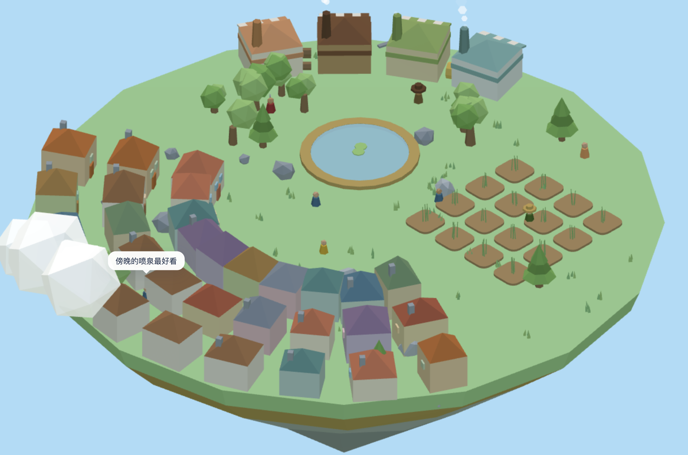

# 云上小镇 Cloudlet

参考《梦想城镇》的 **low-poly 清新风休闲放置 Web 游戏**。Three.js 等距视角，所有模型**程序化生成、零美术资源**。非商业，可挂在屏幕一旁当学习 / 工作陪伴。



---

## 一、游戏介绍（重点）

### 这是一款什么游戏
一座会自己生长的小镇。你播种、看着作物在 low-poly 田野里拔节，把收成送进加工厂，再用产出交付订单、解锁新建筑。节奏舒缓、反馈密集，适合放在副屏挂着，偶尔瞄一眼就有进展。

### 画面与表现
- **程序化 low-poly**：树木、建筑、农田、居民全部由代码生成，仓库不含任何贴图 / 模型文件，克隆即可跑。
- **等距视角 + 自动运镜**：30 秒无操作镜头自动环绕小镇；入夜后窗户次第亮灯。
- **飘字与音效反馈**：收获、交付、升级都有即时反馈，不靠数值堆砌爽感。

### 核心玩法闭环
> 种植 → 加工 → 订单 / 心愿 → 建造 / 装饰 → 繁荣度 → 解锁新岛

- **种植**：11 种作物，按生长时间戳自然成熟；生长速度叠加**岛屿加成 × 收集奖励 × 当季 × 昼夜 × 节日**五重倍率。
- **加工**：8 座工厂 / 8 种加工品（面包/黄油/果酱/木材/牛奶/奶酪/蔗糖/香水），专注期间可自动开工。
- **订单**：村民委托，带名字与小费；交付换金币与经验。
- **心愿**：居民的个人请求，满足后给金币 + 宝石（宝石因此成为「玩出来」的货币）。
- **建造 / 装饰**：18 种建筑 + 12 种装饰，装饰提供繁荣度与满意度。
- **多岛**：6 座岛各有产出偏向（果园岛水果快、牧场岛奶制品快、温泉岛收入高、云顶全面加速）。

### 时间的三层节律
- **昼夜**：夜里作物 +15%、被动收益 +20%，居民回家、窗户亮起。
- **季节**：草地色、环境音、加成作物与限定装饰随季节变化。
- **节日**：樱花祭 / 夏日祭 / 丰收节 / 雪灯节，按日期窗口给额外加成。

### 居民与满意度
- **有去处的居民**：白天去广场/农田/工厂，夜里回家。
- **满意度 0–100**：由装饰占比、心愿达成、公共设施、住房匹配合成，最高让订单收益 +20%。

### 放置与离线收益
- **离线结算**：关掉网页也能产出，离线时长 4–12 小时上限（随等级提升）。
- **local-first 云同步**：进度优先存本地；登录后同步到账号，支持多设备。
- **乐观并发**：推送带版本号，被别的设备改过会返回 409 并按「等级 → 经验 → 时间」裁决，不再静默覆盖。
- **覆盖前快照**：每次覆盖前把旧档存进历史，可经管理接口回滚。

### 爽感与长线
- **一键收获 / 补种**、**Fever 热潮**（连续 5 单收益翻倍）。
- **收集册**：45 项图鉴，集齐一类（作物/加工品/建筑/工厂/装饰）给永久加成。
- **成就目标墙**：19 项成就，带进度条与分组。

### 陪伴系统
- **番茄钟**：25 / 45 / 90 分钟专注期，收益 ×1.5、工厂提速 50%、背景音乐自动压低。
- **开场演出**：首次进入时镜头推近 + 标题卡，可点击跳过。

### 程序化音频
- 七个频道 BGM（city pop / lo-fi / ambient / guitar / country / jazz / 随机轮播），全部 Web Audio 实时合成。
- **环境音层**：白天鸟鸣、夜里虫鸣、常驻风声与雨声，并随季节/节日调整。
- **事件音效**：种植 / 收获 / 金币 / 交付 / 升级 / 热潮 / 点击 / 错误。

---

## 二、设计与架构

### 总体架构

```
浏览器(Three.js 前端)
   │  /api, /admin  →  Nginx / 宝塔反代
   ▼
cloudlet 网关 (server/index.mjs, node:http 零依赖)
   │  注入 X-Sync-Key + X-User-Id，重写全部请求头
   ▼
数据湖租户 /t/cloudlet  (cloudflarepool 通用文档表)
   ├─ c/saves        玩家存档
   ├─ c/accounts     账号档案(密码哈希/等级/会员等级)
   └─ c/usernames    用户名→账号ID 唯一索引
```

### 为什么必须有一层代理网关
数据湖本身直连有五个硬伤，网关一次解决：
- **零 CORS**：浏览器直连 OPTIONS 直接 403；
- **owner 同质**：一把服务密钥下所有玩家 owner 相同，无法隔离；
- **限流共享**：写限流 60/分钟按密钥共享，会被单个玩家打满；
- **没有 upsert**：创建 / 更新需要自己补回退路由；
- **单条 GET 不校验 owner**：任意玩家可越权读他人存档。

走 `X-Sync-Key` 内部通道 + 注入 `X-User-Id` 后，五个问题同时消除，且该通道**豁免限流**。账号 / 密码 / 会话 / JWT 全部由这一层兜底。

### 安全模型
- **密码**：`pbkdf2` 加盐哈希，**明文不出浏览器**。
- **会话**：JWT（HMAC-SHA256，零依赖手写）。
- **双等级校验**：
  - *游戏等级*（Lv / 经验）客户端计算，存档时由网关做合理性校验——等级不倒退、单次跳跃封顶、经验不超过当前等级容量，挡掉改 localStorage 刷等级的作弊。
  - *会员等级*（V1–V4）按累计游玩时长自动晋升（1h→V2、4h→V3、12h→V4），管理后台可手动覆盖，**只升不降**。
- **管理隔离**：后台走独立 `x-admin-token`，与玩家 JWT 完全隔离。
- **网关安全红线**：`INTERNAL_KEY` 是数据湖最高权限密钥（无 scope、豁免限流、可读写任意租户），因此只存在于网关进程环境变量、绝不进前端产物；网关重新构造全部请求头不透传客户端任何头；只允许访问 `/t/cloudlet/c/{saves,accounts,usernames}/` 前缀；设备模式设备 ID 必须是 UUID v4；payload 上限 200KB。

### 目录结构与全局约定

```
src/
  core/        纯逻辑，不依赖渲染。state / actions / simulation / economy / orders / wishes /
               collection / season / festival / daynight / satisfaction / islandBonus / save / cloud / auth
  data/        静态配置表：作物、工厂配方、建筑（含装饰）、物品颜色
  render/      Three.js 层：等距相机、程序化几何体、天气、远景、后处理（移轴）、静态合批
  audio/       Web Audio 程序化 BGM + 环境音层（鸟/虫/风/雨）+ 事件音效
  ui/          HTML overlay：HUD、订单板、心愿板、弹窗、飘字、新手引导、开场演出
server/        网关（node:http 零依赖）：云存档代理 + 账号 + 双等级校验 + 管理后台 + /admin 静态页
deploy/        pm2 配置(ecosystem/start.sh)、.env 示例、nginx 反代示例、初始化与部署脚本
test/          核心玩法冒烟测试
```

三条贯穿全局的约定：
1. **时间用绝对时间戳**（`readyAt`），不用累加计数——离线结算因此天然成立。
2. **逻辑与渲染分离**——`core/` 可在 Node 跑测试，离线结算不需要渲染参与。
3. **外观由种子决定**——存档只存 `seed`，同一颗种子永远长成同一棵树。

---

## 三、安装与部署

### 环境要求
- Node.js 18+
- 部署到 VPS 时可选：pm2（进程守护）、Nginx / 宝塔（反向代理）
- 数据湖二选一：① 微家事网关 T4 数据层（推荐）；② 原始 cloudflarepool（X-Sync-Key）

### 本地开发（零后端也能玩）
```bash
npm install
npm run dev          # 前端 http://localhost:5173
npm test             # 核心玩法冒烟测试
npm run build        # 产物在 dist/，纯静态
```
未登录时存档存在浏览器 `localStorage`（设备 UUID），**断网可玩**。

`vite.config.ts` 已把 `/api` 与 `/admin` 代理到 `127.0.0.1:8787`，所以 `npm run dev` 下云同步与管理后台直接可用。本地联调可起内存模式网关：
```bash
LAKE_BASE=memory://test JWT_SECRET=dev ADMIN_TOKEN=dev npm run server   # 127.0.0.1:8787
curl "http://127.0.0.1:8787/api/health"
```

### 配置
复制示例并填入你自己的值（**`.env.example` 中所有值均为占位，不会泄露**）：
```bash
cp deploy/.env.example deploy/.env
```
数据湖连接二选一（详见 `deploy/.env.example`）：
- **路A（推荐）直接对接微家事网关 T4 数据层**：在 `your-gateway.example.com/admin` 的「密钥」里签发一个 `data:read`+`data:write` 作用域的密钥，把 `raw_secret` 填进 `T4_KEY`，`T4_BASE` 默认即微家事网关。cloudlet 复用同一套数据湖、独立 `cloudlet_*` 表、用户隔离。
- **路B 原始 cloudflarepool**：填 `INTERNAL_KEY`（X-Sync-Key），`LAKE_BASE` 指向数据湖原始地址。

首次部署需先登记租户（幂等，只需一次）：
```bash
export INTERNAL_KEY=<cloudflarepool 的 INTERNAL_KEY>
npm run init:tenant
```

### 部署到 VPS（裸机 + 宝塔反代，无 Docker）
前端静态产物放宝塔站点根目录；网关作为 pm2 常驻进程监听 `127.0.0.1:8787`，宝塔反代把 `/api` 与 `/admin` 指过去，二者同机同源。
```bash
export VPS=user@<YOUR_SERVER_IP>
export JWT_SECRET=$(openssl rand -hex 32) ADMIN_TOKEN=$(openssl rand -hex 16)
# 路C（推荐）：除了网关私钥，还必须给出 T2 令牌的两个身份声明，否则网关拒绝启动
export GATEWAY_KEY='<微家事网关 JWT_PRIVATE_KEY（PKCS#8 PEM）>'
export GATEWAY_APP_ID=weijiashi      # 该租户在数据湖 tenants 表里的 app_id
export GATEWAY_AUD=data.example.com # 数据湖域名，须与上游 aud 校验一致
# 或路B：export INTERNAL_KEY=<原始数据湖 X-Sync-Key>
bash deploy/deploy.sh
```
部署后：站点根路径为游戏，管理后台在 `/admin`（用 `ADMIN_TOKEN` 进入）。网关用 `deploy/start.sh` 包装脚本加载 `.env` 后常驻（pm2 守护进程不继承交互 shell 的环境变量，故不能靠 `source .env && pm2 start`）。

`GATEWAY_APP_ID` / `GATEWAY_AUD` 故意不设默认值：配错时不会「部分可用」，而是所有数据湖请求被上游拒绝，表现为**登录始终失败且提示用户名或密码错误**。

### 登录失败自查（按顺序）
1. `curl https://<你的域名>/api/health` → 检查返回里的 `app` 是否等于数据湖 `tenants.app_id`（cloudlet 租户为 `weijiashi`）。为空或不一致 → 全部请求 403 `forbidden: app mismatch`。
2. 绕过 CDN 直连网关拿真实错误：`curl -X POST http://127.0.0.1:8787/api/auth/login -H 'content-type: application/json' -d '{"username":"x","password":"y"}'`。若返回「数据服务暂不可用（上游 HTTP 403/502）」则是配置/上游问题；只有返回「用户名或密码错误」才是真的密码错。
3. 看网关启动日志：出现 `缺少 GATEWAY_APP_ID` / `缺少 GATEWAY_AUD` 即对应 `.env` 未配。

### 管理后台
`/admin` 提供：玩家存档查看、等级 / 会员等级手动覆盖、密钥管理等。访问需 `ADMIN_TOKEN`。

### 云存档历史（覆盖前快照）
多设备同时自动同步时是「最后写入者胜 + 整体覆盖」，会静默丢进度。网关在**每次覆盖账号存档前**，把即将被覆盖的那份存进 `cloudlet_saves_history`（`app_id`/`owner` 与存档一致），默认每个账号保留最近 **12** 份、最小间隔 **10 分钟**（自动同步每 60s 一次，不设间隔会把历史冲成几分钟）。

- 快照异步落库，不占写档响应时间；失败只打日志，绝不影响存档。
- 仅账号模式产生快照；设备 UUID 模式一台设备独占，不存在互相覆盖。
- 回滚（需 `ADMIN_TOKEN`）：

```bash
# 1) 列出某账号的快照
curl -H 'x-admin-token: <ADMIN_TOKEN>' \
  'https://<域名>/api/admin/saves/<accountId>/history'
# 2) 回滚到指定快照（恢复前会自动把「当前档」也存一份，回滚本身可撤销）
curl -X POST -H 'x-admin-token: <ADMIN_TOKEN>' -H 'content-type: application/json' \
  -d '{"historyId":"<accountId>-<ts>-<rand>"}' \
  'https://<域名>/api/admin/saves/<accountId>/restore'
```

回滚会同时校正账号镜像里的 level/exp，避免客户端下次推送被「等级跳变」判 400。可调参数：`SAVE_HISTORY_KEEP`、`SAVE_SNAPSHOT_INTERVAL_MS`、`LAKE_COLLECTION_HISTORY`。

---

## 路线图

- [ ] 季节活动（每两周轮换，季节限定作物与装饰）
- [ ] 果园岛 / 牧场岛 / 温泉岛 / 云顶（数据结构已就绪，按繁荣度解锁）
- [ ] 装饰自由摆放

---

## 许可证

[MIT](LICENSE) © 2026 joevan
